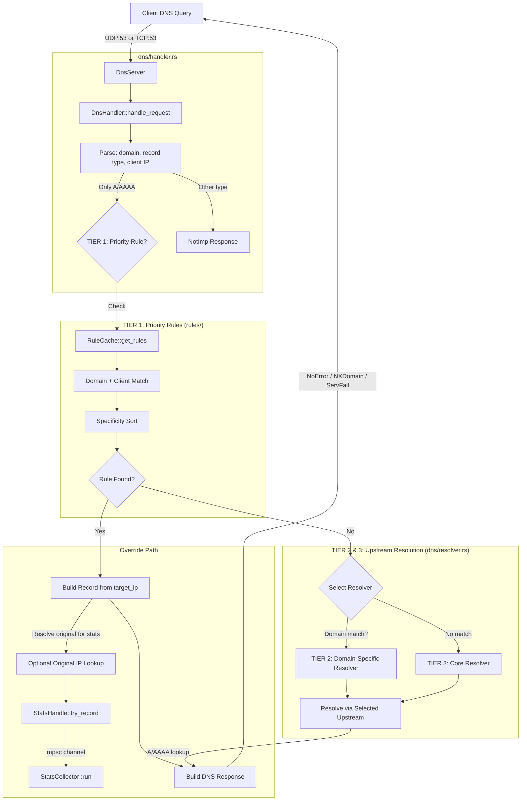
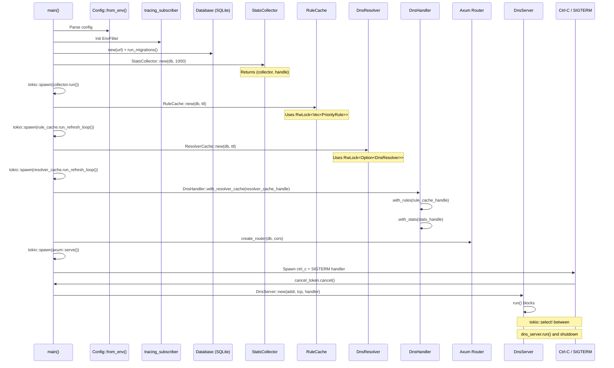

# Goblin DNS Redirector - Backend Architecture

A high-performance, async DNS redirector resolver built in Rust. It intercepts standard DNS queries, matches them against configurable priority rules (by domain and client IP/CIDR), and returns overridden IP addresses. Non-matching queries are forwarded to configurable upstream resolvers.

## Table of Contents

- [Quick Start](#quick-start)
- [Project Structure](#project-structure)
- [Architecture Overview](#architecture-overview)
- [Module Details](#module-details)
  - [Configuration (`config.rs`)](#configuration-configrs)
  - [Database Layer (`db/`)](#database-layer-db)
  - [DNS Server (`dns/`)](#dns-server-dns)
  - [Rule Engine (`rules/`)](#rule-engine-rules)
  - [Statistics (`stats/`)](#statistics-stats)
  - [REST API (`api/`)](#rest-api-api)
- [DNS Query Processing Flow](#dns-query-processing-flow)
- [Application Bootstrap](#application-bootstrap)
- [Database Schema](#database-schema)
- [Design Patterns](#design-patterns)
- [Dependencies](#dependencies)

## Quick Start

```bash
cd backend
cargo run --release

# Initialize database (first run)
sqlite3 goblin.db < migrations/001_initial.sql
```

The DNS server listens on `0.0.0.0:53` (UDP/TCP). The REST API listens on `0.0.0.0:8080`.

```bash
# Test with dig
dig @127.0.0.1 example.com
curl http://localhost:8080/api/v1/health

# View complete API documentation in browser
open http://localhost:8080/api/v1/docs
```

## Project Structure

```
backend/
├── Cargo.toml
├── Containerfile
├── migrations/
│   └── 001_initial.sql
└── src/
    ├── main.rs           # Entry point, signal handling, task orchestration
    ├── config.rs         # CLI args + environment-based configuration
    ├── db/
    │   ├── mod.rs        # Module re-exports
    │   ├── models.rs     # Domain models: UpstreamResolver, PriorityRule, Statistic
    │   └── queries.rs    # Database struct with all SQL operations
    ├── dns/
    │   ├── mod.rs        # Module re-exports
    │   ├── server.rs     # Hickory DNS server (UDP + TCP) wrapper
    │   ├── handler.rs    # DNS request handler implementing RequestHandler trait
    │   ├── resolver.rs   # Multi-resolver with domain-based routing
    │   └── cache.rs      # In-memory resolver cache with periodic refresh
    ├── rules/
    │   ├── mod.rs        # Module re-exports
    │   ├── cache.rs      # In-memory rule cache with periodic refresh
    │   └── matcher.rs    # Domain + client IP matching logic
    ├── stats/
    │   ├── mod.rs        # Module re-exports
    │   └── collector.rs  # Async stats collector via mpsc channel
    └── api/
        ├── mod.rs        # Module re-exports
        ├── routes.rs     # Axum router + CORS setup
        ├── models.rs     # Request/Response DTOs
        └── handlers.rs   # REST endpoint handlers
```

## Architecture Overview

The system follows a **layered architecture** with clear separation of concerns:

```
                    ┌──────────────┐
    DNS queries     │  DNS Server  │  (port 53, UDP/TCP)
    ──────────────► │  (Hickory)   │
                    └──────┬───────┘
                           │
                    ┌──────▼───────┐
                    │   Request    │
                    │    Handler   │
                    └──┬───┬───┬───┘
                       │   │   │
          ┌────────────┘   │   └──────────────┐
          ▼                ▼                   ▼
   ┌──────────┐    ┌───────────┐      ┌──────────────┐
   │ Rule     │    │ Upstream  │      │  Stats       │
   │ Cache    │    │ Resolver  │      │  Collector   │
   │ Match?   │    │ (Hickory) │      │  (mpsc + SQLite)│
   └──────────┘    └───────────┘      └──────────────┘
                                                   
                    ┌──────────────┐
                    │   SQLite     │
                    │  (WAL mode)  │
                    └──────────────┘

                    ┌──────────────┐
    REST API        │    Axum      │  (port 8080)
    ──────────────► │  Web Server  │
                    └──────────────┘
```

The DNS server handles incoming queries on port 53, the rule engine determines whether to override resolution, the upstream resolver handles normal queries, and the stats collector asynchronously persists hit data. Concurrently, the REST API serves management endpoints on port 8080.

## Module Details

### Configuration (`config.rs`)

Configuration is parsed via `clap` derive macros with environment variable fallback:

| Field | Env Variable | Default |
|---|---|---|
| `dns_bind_address` | `DNS_BIND_ADDRESS` | `0.0.0.0:53` |
| `dns_tcp_enabled` | `DNS_TCP_ENABLED` | `true` |
| `api_bind_address` | `API_BIND_ADDRESS` | `0.0.0.0:8080` |
| `api_cors_enabled` | `API_CORS_ENABLED` | `true` |
| `database_path` | `DATABASE_PATH` | `./goblin.db` |
| `rules_cache_ttl` | `RULES_CACHE_TTL` | `60` (seconds) |
| `log_level` | `LOG_LEVEL` | `info` |
| `default_upstream` | `DEFAULT_UPSTREAM` | `8.8.8.8:53` |

```rust
struct Config {
    dns_bind_address: SocketAddr,
    dns_tcp_enabled: bool,
    api_bind_address: SocketAddr,
    api_cors_enabled: bool,
    database_path: String,
    rules_cache_ttl: u64,
    log_level: String,
    default_upstream: String,
}
```

`CliArgs` wraps the clap parser (all fields `Option<T>`), resolved via `Config::from_env()` with defaults applied. The database path is formatted into a `sqlx://` URL via `database_url()`.

### Database Layer (`db/`)

**`models.rs`** defines three domain structs:

```rust
struct UpstreamResolver {
    id: i64,
    ip_address: String,
    domain: String,
    created_at: i64,
    updated_at: i64,
}

struct PriorityRule {
    id: i64,
    domain: String,
    client_filter: Option<String>,  // None = all clients; exact IP or CIDR otherwise
    target_ip: String,              // IP to return in DNS response
    active: bool,
    created_at: i64,
    updated_at: i64,
}

struct Statistic {
    id: i64,
    rule_id: i64,
    client_ip: String,
    requested_domain: String,
    original_ip: Option<String>,    // IP returned by upstream resolver
    overridden_ip: String,          // IP from the matched rule
    timestamp: i64,
}

struct StatsSummary {
    total_hits: i64,
    unique_clients: i64,
    active_rules: i64,
}
```

**`queries.rs`** provides the `Database` struct wrapping an `SqlitePool`:

```rust
struct Database {
    pool: SqlitePool,  // SQLite connection pool with WAL mode
}
```

Key methods: `run_migrations()`, CRUD for resolvers and rules (including `toggle_rule()`), `record_stat()`, paginated stats queries (`get_all_stats`), per-rule stats (`get_stats_for_rule`), and `get_stats_summary()` with aggregation.

### DNS Server (`dns/`)

**`server.rs`** — Wraps Hickory's `ServerFuture`:

```rust
struct DnsServer {
    bind_address: SocketAddr,
    tcp_enabled: bool,
    handler: DnsHandler,
}
```

`run()` registers UDP and optionally TCP sockets, then blocks.

**`resolver.rs`** — Multi-resolver system with domain-based routing:

```rust
struct DomainResolver {
    resolver: TokioAsyncResolver,  // Hickory async resolver
    domain: String,                // Associated domain or "core"
    ip_address: String,            // Upstream DNS server address
}

struct DnsResolver {
    domain_resolvers: HashMap<String, DomainResolver>,  // Domain-specific resolvers
    core_resolvers: Vec<DomainResolver>,                // Fallback resolvers
}
```

`from_upstreams(upstreams)` creates a resolver instance from a list of `UpstreamResolver` records, automatically separating domain-specific resolvers from core resolvers. `select_resolver(domain)` implements the tier-2/tier-3 logic: exact domain match → subdomain match → first core resolver. Provides `resolve(domain, record_type)`, `resolve_a(domain)`, and `resolve_aaaa(domain)` methods.

**`cache.rs`** — In-memory resolver cache with periodic refresh:

```rust
struct ResolverCache {
    db: Arc<Database>,
    resolver: Arc<RwLock<Option<Arc<DnsResolver>>>>,
    refresh_interval: Duration,
}

struct ResolverCacheHandle {
    cache: Arc<ResolverCache>,
}
```

Similar to `RuleCache`, this periodically refreshes the upstream resolver configuration from the database and rebuilds the `DnsResolver` instance. The handler uses `ResolverCacheHandle` to get the current resolver configuration.

**`handler.rs`** — Core request handler implementing `hickory_server::server::RequestHandler`:

```rust
struct DnsHandler {
    resolver_cache: Option<ResolverCacheHandle>,
    fallback_resolver: Option<Arc<DnsResolver>>,
    rule_cache: Option<RuleCacheHandle>,
    stats_handle: Option<StatsHandle>,
}
```

Uses a **builder pattern** for chaining:

```rust
// Using resolver cache (recommended)
DnsHandler::with_resolver_cache(resolver_cache_handle)
    .with_rules(rule_cache_handle)
    .with_stats(stats_handle)

// Using static resolver (legacy/fallback)
DnsHandler::new(resolver)
    .with_rules(rule_cache_handle)
    .with_stats(stats_handle)
```

The `handle_query()` method implements the three-tier resolution flow:
1. **TIER 1**: Check `rule_cache` first — if a rule matches, return the `target_ip`
2. **TIER 2**: If no rule matches, get resolver from cache and let it select domain-specific resolver
3. **TIER 3**: Resolver automatically falls back to core resolvers if no domain match

All returned records use a hardcoded TTL of 300 seconds.

### Rule Engine (`rules/`)

**`matcher.rs`** — Pure matching functions with specificity priority:

```rust
fn client_matches(&rule, client_ip) -> bool
fn domain_matches(&rule, requested_domain) -> bool
fn find_matching_rule(&rules, domain, client_ip) -> Option<&PriorityRule>
```

`domain_matches()` does case-insensitive exact matching, stripping trailing dots.

`client_matches()` handles three modes: `None` (all clients), exact IP string comparison, and CIDR matching via `ipnetwork`.

`find_matching_rule()` implements a **specificity priority** sort:

1. Filter: `active == true` AND `domain_matches`
2. Filter by `client_matches`
3. Sort by specificity: **exact IP > CIDR (longer prefix wins) > no filter**
4. Return the most specific match (first in sorted order)

**`cache.rs`** — In-memory cache with periodic DB refresh:

```rust
struct RuleCache {
    db: Arc<Database>,
    rules: Arc<RwLock<Vec<PriorityRule>>>,
    refresh_interval: Duration,
}

struct RuleCacheHandle {
    cache: Arc<RuleCache>,
}
```

`RuleCache` uses `Arc<RwLock<Vec<PriorityRule>>>` for concurrent reads with infrequent writes. `RuleHandle` is a cloneable wrapper hidden behind `Arc`. The `run_refresh_loop()` task calls `refresh()` (fetching active rules from DB) every `RULES_CACHE_TTL` seconds.

### Statistics (`stats/`)

**`collector.rs`** — Decouples DNS query handling from database writes via an `mpsc` channel:

```rust
struct StatEvent {
    rule_id: i64,
    client_ip: String,
    requested_domain: String,
    original_ip: Option<String>,
    overridden_ip: String,
}

struct StatsCollector {
    db: Arc<Database>,
    receiver: mpsc::Receiver<StatEvent>,
}

struct StatsHandle {
    sender: mpsc::Sender<StatEvent>,
}
```

`StatsHandle::try_record()` sends non-blocking (drops events when the 1000-item buffer is full). `StatsCollector::run()` is a spawned async task that receives events and persists them via `db.record_stat()`.

### REST API (`api/`)

**`routes.rs`** — Sets up the Axum router with all endpoints under `/api/v1`:

| Method | Path | Handler |
|---|---|---|
| GET | `/api/v1/health` | Health check |
| GET | `/api/v1/docs` | Complete API documentation (HTML) |
| GET/POST/GET/PUT/DELETE | `/api/v1/resolvers` | Upstream resolver CRUD |
| GET/POST/GET/PUT/PATCH/DELETE | `/api/v1/rules` | Priority rule CRUD + toggle |
| GET | `/api/v1/stats` | Paginated statistics |
| GET | `/api/v1/stats/rules/:rule_id` | Per-rule statistics |
| GET | `/api/v1/stats/summary` | Aggregated summary |

A generic `ApiResponse<T>` wrapper provides consistent JSON responses: `{"success": bool, "data": T?, "error": String?}`. CORS is configurable via `API_CORS_ENABLED`.

**API Documentation** — Visit `http://localhost:8080/api/v1/docs` in your browser for interactive HTML documentation with detailed endpoint descriptions, request/response examples, and a quick start guide.

**`models.rs`** defines request/response DTOs including `CreateRuleRequest`, `UpdateRuleRequest` (with `Option<Option<T>>` for optional fields), `StatsQuery`, and `StatsSummaryResponse`.

## DNS Query Processing Flow

The system implements a **three-tier DNS resolution flow** with clear priority ordering:

### Resolution Tiers

**Tier 1: Priority Rules** (Highest Priority)
- Domain-specific overrides with optional client IP/CIDR filtering
- Returns a configured `target_ip` instead of performing actual DNS resolution
- Used for blocking, redirecting, or A/B testing

**Tier 2: Domain-Specific Upstream Resolvers**
- Upstream DNS servers associated with specific domains or domain patterns
- Queries for matched domains are resolved using the associated upstream resolver
- Supports subdomain matching (e.g., `api.example.com` matches resolver for `example.com`)

**Tier 3: Core Upstream Resolvers** (Fallback)
- General-purpose upstream DNS servers marked with domain `"core"`
- Handle all queries that don't match priority rules or domain-specific resolvers
- Ensures all queries can be resolved even without specific configuration

### Flow Diagram



### Resolution Algorithm

```
function resolve_query(domain, client_ip, record_type):
    # TIER 1: Check priority rules
    for rule in active_priority_rules:
        if rule.domain matches domain AND
           rule.client_filter matches client_ip:
            
            # Optional: Resolve original IP for statistics
            original_ip = upstream_resolve(domain, record_type)
            
            # Record statistics
            record_stat(rule, client_ip, domain, original_ip, rule.target_ip)
            
            # Return overridden IP
            return dns_record(rule.target_ip, TTL=300)
    
    # TIER 2: Check domain-specific upstream resolvers
    for resolver in domain_specific_resolvers:
        if resolver.domain == domain OR
           domain is subdomain of resolver.domain:
            return resolver.resolve(domain, record_type)
    
    # TIER 3: Use core upstream resolver (fallback)
    for resolver in core_resolvers:
        return resolver.resolve(domain, record_type)
    
    # No resolver available
    return ServFail
```

### Step-by-Step Processing

1. **Packet arrival**: Client sends DNS query to bind address over UDP or TCP
2. **Server setup**: `DnsServer` registers socket with `ServerFuture::new(handler)`
3. **Handler dispatch**: `DnsHandler::handle_request()` is called by Hickory's server loop
4. **Query parsing**: Extract domain, record type, and client IP from the request
5. **Type check**: Only `A` and `AAAA` queries are handled; others receive `NotImp`

6. **TIER 1 - Priority Rule Lookup**:
   - Fetch active rules from `RuleCache`
   - Filter by domain match (case-insensitive, exact match)
   - Filter by client IP match (exact IP, CIDR, or NULL for all clients)
   - Sort by specificity: exact IP > CIDR (longer prefix) > no filter
   - If rule found: return `target_ip`, optionally record stats
   
7. **TIER 2 - Domain-Specific Resolver**:
   - Check if domain matches any configured domain-specific resolver
   - Match exact domain or subdomain (e.g., `api.example.com` → `example.com`)
   - If matched: use associated upstream resolver to perform DNS query
   
8. **TIER 3 - Core Resolver Fallback**:
   - If no priority rule or domain-specific resolver matches
   - Use first available "core" upstream resolver
   - Perform standard DNS query through upstream

9. **Response**: `MessageResponseBuilder` constructs the DNS response with `NoError`, `NXDomain`, `ServFail`, or `NotImp`

### Domain Matching Logic

Domain matching is **case-insensitive** and handles DNS normalization:

- Trailing dots are stripped: `example.com.` → `example.com`
- Case normalized: `EXAMPLE.COM` → `example.com`
- Subdomain matching: `api.example.com` matches resolver for `example.com`
- Exact match takes precedence over subdomain match

### Upstream Resolver Configuration

Upstream resolvers are stored in the `upstream_resolvers` table with a `domain` field:

- **Domain-specific**: `domain = "example.com"` → handles `example.com` and `*.example.com`
- **Core/Fallback**: `domain = "core"` → handles all unmatched queries

Example configuration:

```sql
-- Core resolver (fallback for all queries)
INSERT INTO upstream_resolvers (ip_address, domain, created_at, updated_at)
VALUES ('8.8.8.8:53', 'core', unixepoch(), unixepoch());

-- Domain-specific resolver for company internal domains
INSERT INTO upstream_resolvers (ip_address, domain, created_at, updated_at)
VALUES ('10.0.0.53:53', 'company.internal', unixepoch(), unixepoch());

-- Domain-specific resolver for example.com
INSERT INTO upstream_resolvers (ip_address, domain, created_at, updated_at)
VALUES ('1.1.1.1:53', 'example.com', unixepoch(), unixepoch());
```

### Resolution Flow Examples

**Example 1**: Query for `google.com` from `192.168.1.100`
- TIER 1: No priority rule matches → continue
- TIER 2: No domain-specific resolver for `google.com` → continue
- TIER 3: Use core resolver `8.8.8.8:53` → resolve normally

**Example 2**: Query for `blocked.com` from `192.168.1.100` (with priority rule)
- TIER 1: Priority rule matches (`blocked.com` → `0.0.0.0`) → return `0.0.0.0`
- TIER 2: Not reached
- TIER 3: Not reached

**Example 3**: Query for `api.company.internal` from `10.0.0.50`
- TIER 1: No priority rule matches → continue
- TIER 2: Domain-specific resolver matches `company.internal` → use `10.0.0.53:53`
- TIER 3: Not reached

**Example 4**: Query for `www.example.com` from `192.168.2.100`
- TIER 1: No priority rule matches → continue
- TIER 2: Domain-specific resolver matches `example.com` (subdomain) → use `1.1.1.1:53`
- TIER 3: Not reached

## Application Bootstrap

`main.rs` orchestrates all components with a shared `CancellationToken` for graceful shutdown:



Bootstrap order:

1. Parse config (`Config::from_env()`)
2. Initialize `tracing_subscriber` with `EnvFilter`
3. Connect SQLite, enable WAL mode, run migrations
4. Create `StatsCollector` (returns collector + `StatsHandle`), spawn as task
5. Create `RuleCache` with refresh interval, spawn refresh loop task
6. Create `ResolverCache` with refresh interval, spawn refresh loop task
7. Create fallback `DnsResolver` with default upstream config (used if no upstreams configured)
8. Build `DnsHandler` via builder pattern, using resolver cache and chaining in rules and stats
9. Create Axum router with all routes + optional CORS
10. Spawn HTTP server on `api_bind_address`
11. Set up Ctrl-C and SIGTERM handlers that call `cancel()` on the shared token
12. Run `DnsServer::run()` (blocking), selected against shutdown signal

## Database Schema

**upstream_resolvers** — Maps domains to upstream DNS server IPs:

| Column | Type | Notes |
|---|---|---|
| id | INTEGER | PK, autoincrement |
| ip_address | TEXT | Upstream resolver IP |
| domain | TEXT | Domain this resolver handles |
| created_at | INTEGER | Unix timestamp |
| updated_at | INTEGER | Unix timestamp |

*Constraint: `UNIQUE(ip_address, domain)`*

**priority_rules** — Overrides for DNS resolution:

| Column | Type | Notes |
|---|---|---|
| id | INTEGER | PK, autoincrement |
| domain | TEXT | Domain to match |
| client_filter | TEXT | NULL=all, else exact IP or CIDR |
| target_ip | TEXT | IP to return |
| active | INTEGER | 0=inactive, 1=active |
| created_at | INTEGER | Unix timestamp |
| updated_at | INTEGER | Unix timestamp |

*Constraint: `UNIQUE(domain, client_filter)`*

**statistics** — Tracks DNS query hits against rules:

| Column | Type | Notes |
|---|---|---|
| id | INTEGER | PK, autoincrement |
| rule_id | INTEGER | FK -> priority_rules.id |
| client_ip | TEXT | Query source IP |
| requested_domain | TEXT | Query domain |
| original_ip | TEXT | Upstream resolver response |
| overridden_ip | TEXT | Rule target IP |
| timestamp | INTEGER | Query time |

## Design Patterns

| Pattern | Usage |
|---|---|
| **Builder pattern** | `DnsHandler::new(resolver).with_rules(handle).with_stats(handle)` for composed request handling |
| **Channel-based decoupling** | `StatsHandle` / `StatsCollector` use `mpsc` to avoid blocking DNS handler on DB writes |
| **Handle pattern** | `RuleCacheHandle` and `StatsHandle` hide internal `Arc` complexity, are `Clone`, and can be shared across tasks |
| **RwLock for concurrent reads** | `RuleCache` uses `Arc<RwLock<Vec<PriorityRule>>>` allowing concurrent rule lookups with infrequent background refresh |
| **CancellationToken for shutdown** | Single `CancellationToken` shared across all spawned tasks; `tokio::select!` listens for cancel signal |
| **WAL mode** | SQLite operates in Write-Ahead Logging mode for better concurrent read/write performance |

## Class Diagram

```mermaid
classDiagram
    class Config {
        +dns_bind_address: SocketAddr
        +dns_tcp_enabled: bool
        +api_bind_address: SocketAddr
        +api_cors_enabled: bool
        +database_path: String
        +rules_cache_ttl: u64
        +log_level: String
        +default_upstream: String
        +from_env() Config
        +database_url() String
    }

    class CliArgs {
        +dns_bind_address: Option~SocketAddr~
        +dns_tcp_enabled: Option~bool~
        +api_bind_address: Option~SocketAddr~
        +api_cors_enabled: Option~bool~
        +database_path: Option~String~
        +rules_cache_ttl: Option~u64~
        +log_level: Option~String~
        +default_upstream: Option~String~
    }

    Config --> CliArgs : "parsed from"

    class Database {
        -pool: SqlitePool
        +new(url) Database
        +run_migrations()
        +get_all_resolvers() Vec~UpstreamResolver~
        +create_resolver(ip, domain) i64
        +update_resolver(id, ip, domain) bool
        +delete_resolver(id) bool
        +get_all_rules() Vec~PriorityRule~
        +get_active_rules() Vec~PriorityRule~
        +create_rule(domain, client_filter, target_ip, active) i64
        +update_rule(id, domain, client_filter, target_ip, active) bool
        +toggle_rule(id) bool
        +delete_rule(id) bool
        +record_stat(rule_id, client_ip, domain, original_ip, overridden_ip)
        +get_all_stats(limit, offset) Vec~Statistic~
        +get_stats_for_rule(rule_id) Vec~Statistic~
        +get_stats_summary() StatsSummary
    }

    class PriorityRule {
        +id: i64
        +domain: String
        +client_filter: Option~String~
        +target_ip: String
        +active: bool
        +created_at: i64
        +updated_at: i64
    }

    class UpstreamResolver {
        +id: i64
        +ip_address: String
        +domain: String
        +created_at: i64
        +updated_at: i64
    }

    class Statistic {
        +id: i64
        +rule_id: i64
        +client_ip: String
        +requested_domain: String
        +original_ip: Option~String~
        +overridden_ip: String
        +timestamp: i64
    }

    class StatsSummary {
        +total_hits: i64
        +unique_clients: i64
        +active_rules: i64
    }

    class DnsServer {
        -bind_address: SocketAddr
        -tcp_enabled: bool
        -handler: DnsHandler
        +new(addr, tcp, handler)
        +run()
    }

    class DnsHandler {
        -resolver: Arc~DnsResolver~
        -rule_cache: Option~RuleCacheHandle~
        -stats_handle: Option~StatsHandle~
        +new(resolver) DnsHandler
        +with_rules(handle) DnsHandler
        +with_stats(handle) DnsHandler
        +handle_query(request) Vec~Record~
        +handle_request(request, handle) ResponseInfo
    }

    class DnsResolver {
        -resolver: TokioAsyncResolver
        +new(upstream) Self
        +resolve(domain, type) Vec~IpAddr~
        +resolve_a(domain) Vec~IpAddr~
        +resolve_aaaa(domain) Vec~IpAddr~
    }

    class RuleCache {
        -db: Arc~Database~
        -rules: Arc~RwLock~Vec~PriorityRule~~~
        -refresh_interval: Duration
        +new(db, ttl) Self
        +get_rules() Vec~PriorityRule~
        +refresh() Result~usize~~
        +run_refresh_loop()
    }

    class RuleCacheHandle {
        -cache: Arc~RuleCache~
        +get_rules() Vec~PriorityRule~
        +refresh() Result~usize~~
    }

    class RuleMatcher

    class StatEvent {
        +rule_id: i64
        +client_ip: String
        +requested_domain: String
        +original_ip: Option~String~
        +overridden_ip: String
    }

    class StatsCollector {
        -db: Arc~Database~
        -receiver: mpsc::Receiver~StatEvent~
        +new(db, buffer) (Self, Sender~StatEvent~~)
        +run()
    }

    class StatsHandle {
        -sender: mpsc::Sender~StatEvent~
        +record(event) bool
        +try_record(event) bool
    }

    class AppState {
        +db: Arc~Database~
    }

    class Routes {
        +create_router(db, cors) Router
    }

    class CreateRuleRequest {
        +domain: String
        +client_filter: Option~String~
        +target_ip: String
        +active: bool
    }

    class UpdateRuleRequest {
        +domain: Option~String~
        +client_filter: Option~Option~String~~
        +target_ip: Option~String~
        +active: Option~bool~
    }

    class StatsSummaryResponse {
        +total_hits: i64
        +unique_clients: i64
        +active_rules: i64
    }

    class ApiResponse~T~ {
        +success: bool
        +data: Option~T~
        +error: Option~String~
        +success(data) ApiResponse~T~~
        +error(msg) ApiResponse~T~~
    }

    Database --> PriorityRule : "CRUD"
    Database --> UpstreamResolver : "CRUD"
    Database --> Statistic : "record/query"
    Database --> StatsSummary : "aggregate"
    PriorityRule ..> RuleMatcher : "matched by"

    DnsServer --> DnsHandler : "owns"
    DnsHandler --> DnsResolver : "owns"
    DnsHandler --> RuleCacheHandle : "uses (optional)"
    DnsHandler --> StatsHandle : "uses (optional)"

    RuleCache --> Database : "reads from"
    RuleCacheHandle --> RuleCache : "wraps"

    RuleCache -right-> PriorityRule : "caches"
    StatsCollector --> Database : "writes to"
    StatsCollector ..> StatEvent : "receives via channel"
    StatsHandle --> StatEvent : "sends via channel"

    Routes --> AppState : "uses state"
    AppState --> Database : "owns"
    Api~~> ApiResponse : "wraps"
```

## Dependencies

| Category | Crate | Purpose |
|---|---|---|
| **Async Runtime** | `tokio`, `tokio-util` | Async runtime, CancellationToken |
| **DNS** | `hickory-server`, `hickory-resolver`, `hickory-proto` | DNS server protocol, upstream resolution |
| **Web** | `axum`, `tower`, `tower-http` | HTTP API, CORS, tracing middleware |
| **Database** | `sqlx` (sqlite, tokio, migrate) | Compile-time checked SQL + migrations |
| **Serialization** | `serde`, `serde_json` | JSON serialization |
| **Networking** | `ipnetwork` | CIDR network matching |
| **Error Handling** | `anyhow`, `thiserror` | Error chaining + ergonomic errors |
| **Logging** | `tracing`, `tracing-subscriber` (env-filter) | Structured logging |
| **CLI** | `clap` (derive) | Argument parsing with env var fallback |
| **Utilities** | `chrono` (serde), `async-trait` | Timestamps, async trait support |
